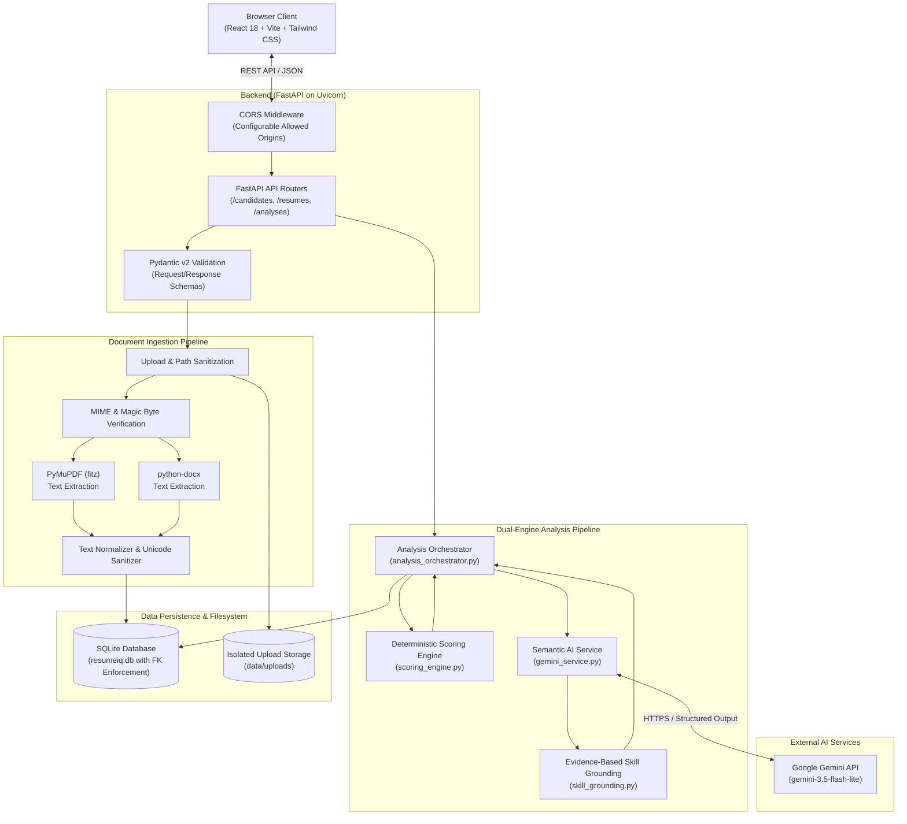
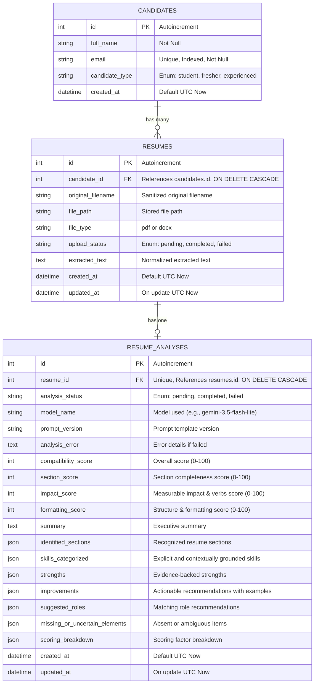
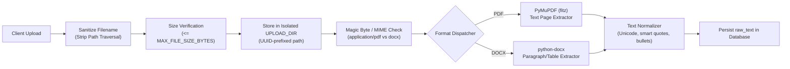
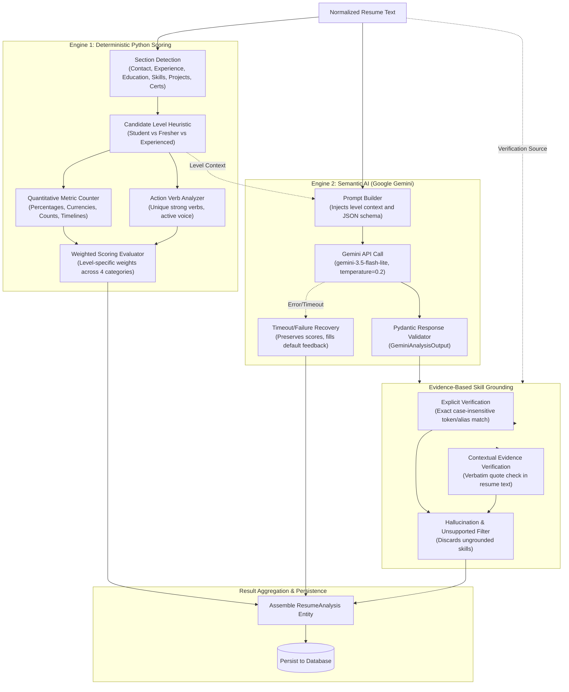

# ResumeIQ — Architecture Documentation

This document describes the architectural design, system components, data models, document ingestion pipeline, dual-engine analysis engine, and security mechanisms of **ResumeIQ**.

---

## 1. High-Level System Architecture

ResumeIQ is built as a decoupled, multi-tier web application combining a responsive Single Page Application (SPA) frontend with a high-performance asynchronous REST backend. Resume evaluation is conducted through a hybrid architecture pairing a **deterministic Python scoring engine** with **Google Gemini 2.5 Flash Lite** structured semantic analysis.



---

## 2. Frontend Architecture

The frontend is a modern React 18 single-page application bundled with Vite and styled with Tailwind CSS.

### 2.1 Component Structure & Separation of Concerns

- **Pages / Views (`frontend/src/pages/`)**:
  - `Dashboard`: Overview of candidate pipeline, recent uploads, and system health status.
  - `CandidateList` / `CandidateDetail`: Candidate profile management and resume history.
  - `ResumeUpload`: Drag-and-drop file uploader with client-side extension and file size validation.
  - `ResumeAnalysisView`: Multi-tab analytical breakdown:
    - Overall score gauge & sub-score breakdown (Format, Content/Impact, Skills, Experience/Relevance).
    - Detected candidate experience level (Student, Fresher, Experienced).
    - Section-by-section breakdown with detected action verbs and quantifiable metrics.
    - AI qualitative review: Strengths, Areas for Improvement, Missing/Uncertain Elements.
    - Grounded skill taxonomy categorized into verified Explicit Skills and Contextually Evidenced Skills with quote snippets.
- **State & API Service Layer (`frontend/src/services/api.js`)**:
  - Centralized Axios client configured with base URL targeting `/api`.
  - Structured API methods for Candidates, Resumes, and Analyses.
  - Consistent error handling intercepting network, 4xx, and 500 responses with user-facing alerts.

---

## 3. Backend Architecture

The backend is built with **FastAPI** running on **Python 3.12**, leveraging asynchronous handlers, Pydantic v2 data validation, and SQLAlchemy ORM.

### 3.1 Layered Organization

```
backend/
├── app/
│   ├── main.py                     # FastAPI app factory, CORS, exception handlers, route mounting
│   ├── api/
│   │   └── routes/                 # HTTP endpoint routers
│   │       ├── health.py           # Service health probe
│   │       ├── candidates.py       # Candidate CRUD operations
│   │       ├── resumes.py          # Upload, extraction, text preview, deletion
│   │       └── analyses.py         # Analysis execution and result retrieval
│   ├── core/
│   │   └── config.py               # Centralized settings via python-dotenv & os.getenv
│   ├── database/
│   │   ├── __init__.py             # SQLAlchemy engine, session maker, SQLite FK listener
│   │   └── dependencies.py         # get_db session dependency
│   ├── models/                     # SQLAlchemy declarative ORM models
│   │   ├── candidate.py            # Candidate model (student, fresher, experienced)
│   │   ├── resume.py               # Resume metadata and parsed text model
│   │   └── analysis.py             # Analysis results model
│   ├── schemas/                    # Pydantic v2 validation models
│   │   ├── candidate.py
│   │   ├── resume.py
│   │   └── analysis.py
│   └── services/                   # Core domain logic
│       ├── document_parser.py      # Binary extraction (PyMuPDF, python-docx) & normalization
│       ├── scoring_engine.py       # Deterministic Python scoring algorithm
│       ├── gemini_service.py       # Gemini client, prompt calibration, structured schemas
│       ├── skill_grounding.py      # Grounding & verbatim evidence verification
│       └── analysis_orchestrator.py # Pipeline coordination and persistence
```

---

## 4. Database Schema & Data Models

ResumeIQ utilizes **SQLite** with strict Foreign Key enforcement enabled via an engine connect event (`PRAGMA foreign_keys=ON;`).



### 4.1 Cascade Rules & Referential Integrity
- Deleting a `Candidate` automatically cascades to delete all associated `Resume` records and their child `ResumeAnalysis` records.
- Deleting a `Resume` automatically cascades to delete its child `ResumeAnalysis` records.
- Sequential re-analysis of a resume replaces existing analysis records idempotently or retrieves the latest record.

---

## 5. Document Ingestion Pipeline

The ingestion pipeline handles file uploads, format verification, text extraction, and sanitization before analysis.



### 5.1 Extraction Features
1. **PyMuPDF (`pdf_service.py`)**:
   - Parses multi-page PDF documents page by page.
   - Extracts plain text blocks preserving layout and paragraph separation.
   - Robust to non-standard fonts and whitespace anomalies.
2. **python-docx (`docx_service.py`)**:
   - Extracts text across all document paragraphs and embedded table cells.
3. **Unicode & Character Normalization**:
   - Replaces smart quotes (`\u201c`, `\u201d`, `\u2018`, `\u2019`) with standard ASCII equivalents.
   - Standardizes bullet characters (`\u2022`, `\u25cf`, `\u25e6`, `-`, `*`).
   - Normalizes non-breaking spaces (`\u00a0`) and multi-line breaks.

---

## 6. Dual-Engine Analysis Pipeline

ResumeIQ uses a dual-engine architecture to guarantee deterministic, transparent scoring alongside generative semantic feedback.



### 6.1 Engine 1: Deterministic Python Scoring (`scoring_engine.py`)

The deterministic scoring algorithm runs entirely locally without network calls, producing an objective score out of 100.

1. **Candidate Level Calibration**:
   - **Student**: Currently enrolled or graduation date in future/present; emphasis on Education, Skills, and Academic Projects.
   - **Fresher**: Recent graduate (< 2 years professional experience); balanced emphasis on Projects, Education, and Skills.
   - **Experienced**: 2+ years of professional history; heavy emphasis on Work Experience, Quantifiable Impact, and Proven Technologies.
2. **Sub-Score Breakdown**:
   - **Format (20 pts)**: Presence of essential contact points (email, phone, LinkedIn), structured section headers, clear formatting.
   - **Content & Impact (25 pts)**: Density of quantifiable metrics (dollar figures, percentages, scale indicators) and diversity of strong action verbs (e.g., *architected*, *engineered*, *accelerated*).
   - **Skills (25 pts)**: Diversity of technical proficiencies, programming languages, libraries, and frameworks mapped to industry taxonomies.
   - **Experience & Relevance (30 pts)**: Chronological progression, project scope, and depth aligned with the detected candidate level.

### 6.2 Engine 2: Semantic AI Analysis (`gemini_service.py`)

- **Model**: `gemini-3.5-flash-lite` via `google-genai` SDK.
- **Low Temperature**: Set to `0.2` to eliminate non-deterministic hallucinations.
- **Pydantic Structured Output**: Enforces strict JSON return matching `GeminiAnalysisOutput`.
- **Fault-Tolerant Recovery**: If Gemini encounters network failure or exceeds timeout limits, the orchestrator preserves the deterministic score and returns safe placeholder feedback, ensuring the user is never blocked.

### 6.3 Evidence-Based Skill Grounding (`skill_grounding.py`)

To prevent AI hallucinations, all skills identified by Gemini undergo strict two-tier grounding:
1. **Explicit Skills**:
   - Must match exact terms or known aliases in the resume text (e.g., "Python", "FastAPI", "React").
   - Unmatched skills are immediately filtered out.
2. **Contextual Skills**:
   - Model must provide a `ContextualSkillItem` containing the `skill` name and verbatim `evidence` text quoted directly from the resume.
   - The grounding engine verifies that the `evidence` substring exists in the normalized resume text.
   - Verbatim matches are confirmed; skills with missing or fabricated evidence quotes are discarded.

---

## 7. Security and Reliability Architecture

ResumeIQ incorporates security and defensive engineering best practices:

### 7.1 Path Traversal & File Storage Safety
- Uploaded filenames are sanitized (`os.path.basename`) to prevent directory traversal attacks (`../`).
- Files are saved with unique UUID prefixes inside a dedicated `RESUMEIQ_UPLOAD_DIR`.
- All file access and deletion operations resolve real canonical paths (`os.path.realpath`) and verify that the target strictly resides inside `RESUMEIQ_UPLOAD_DIR`.
- Symlinks pointing outside the upload directory are rejected.
- Deleting a resume record cleans up the file on disk if valid, but tolerates missing files without crashing database operations.

### 7.2 API Validation & Bounds Checking
- All numerical path identifiers (`candidate_id`, `resume_id`) enforce positive integer validation (`gt=0`). Non-positive IDs immediately return `422 Unprocessable Entity`.
- File uploads enforce a strict `MAX_FILE_SIZE_BYTES` limit (default 5 MB). Uploads exceeding this return `413 Payload Too Large`.
- Unhandled server exceptions return generic `500 Internal Server Error` messages to avoid leaking stack traces or internal implementation details.

### 7.3 Gemini Reliability & Bounded Retries
- Configured with a strict request-level HTTP timeout (default 30 seconds).
- Transient failures (HTTP 429 Rate Limit, HTTP 503 Service Unavailable, connection dropouts) are retried at most **2 times** using bounded exponential backoff with jitter.
- Authentication failures (HTTP 401/403) and client errors (HTTP 400/422) are **never retried**.

### 7.4 Sensitive Data Protection & Redaction
- Logging filters automatically detect and redact Google API keys matching `AIza[0-9A-Za-z-_]{20,50}` across log output, exception messages, and persisted database records.
- Raw resume contents and candidate private information are never emitted into application log files.

### 7.5 Cross-Origin Resource Sharing (CORS)
- Allowed origins are configurable via `CORS_ORIGINS` in `.env`.
- Default configuration allows local development origins (`http://localhost:5173`, `http://127.0.0.1:5173`).
- Rejects unauthorized cross-origin requests.
